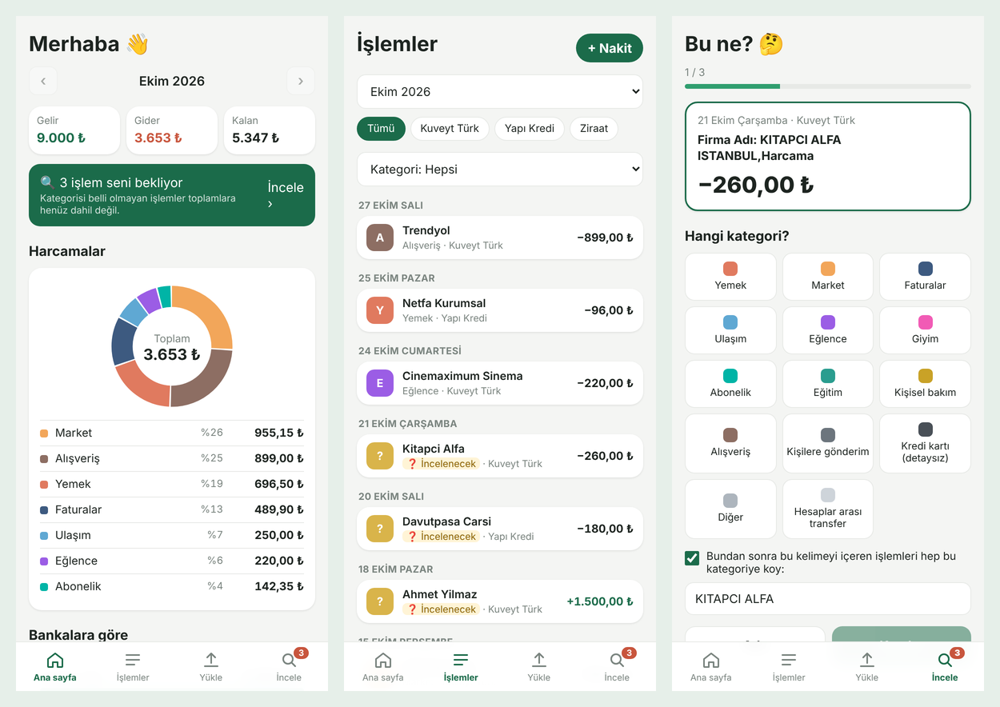

# Cep Bütçe — Pocket Expense Tracker

A personal, mobile-friendly web app that **combines bank statements from several banks into one view**, categorizes every transaction automatically and shows where the money goes — like a fitness tracker, but for money.

**Live app:** https://huzeyfeozdemir.github.io/pocket-expense-tracker/ (add it to your phone's home screen)



*Screenshots use made-up sample data.*

## The problem

I use three banks (Kuveyt Türk, Yapı Kredi, Ziraat). My scholarship arrives in one, family transfers in another, card spending in a third. No single banking app shows my **total** income and spending, so I could never answer "how much did I spend on food this month?".

## What it does (v1)

- **Imports PDF statements** from Kuveyt Türk, Yapı Kredi and Ziraat — the bank is detected automatically
- **Reads photo PDFs too:** when a bank app saves the statement as an image (Ziraat mobile), the text is read with OCR (Tesseract) and every amount is checked against the balance column
- **Share from the bank app:** tap *Share* on a statement in the banking app and pick Cep Bütçe; the statement is imported directly (Web Share Target API, Android)
- **Combines all accounts** into one monthly summary: income, expenses, balance, spending by category and by bank
- **Categorizes automatically** with keyword rules (e.g. `NETFA` → Food, `TURKCELL` → Bills)
- **Review box:** asks *"what is this?"* for transactions it cannot recognize, and **learns** the answer as a new rule
- **No double counting:** the same statement line is never imported twice; transfers between my own accounts are excluded from totals
- **Manage statements:** see every uploaded statement (bank, period, number of transactions) and delete one together with its transactions
- **Cash entries** for spending that never shows up on a statement
- **Password-protected PDFs:** asks for the statement password and opens it
- **Refunds** (`İADE`) go back into the shop's category and lower that spending instead of counting as income
- **Search and drill-down:** tap a category or bank on the home screen to see its transactions; search the list by text or amount, with in/out totals
- **Month-to-month comparison** of income and spending on the home screen
- **Private by design:** all data stays on the phone (SQLite in the browser); backup / restore as a file
- Installable as an app (PWA) and works offline

## How it was built

I approached it like a business analyst first, then built it:

| Step | Output |
|---|---|
| 1. Requirements | [User stories with priorities (MoSCoW)](docs/requirements.md) |
| 2. Screen design | [Wireframes of the 4 screens](docs/wireframes.png) |
| 3. Data model | [ER diagram](docs/er-diagram.png) · [SQL schema](sql/schema.sql) · [Main queries](sql/queries.sql) |
| 4. Build | HTML, CSS, JavaScript · SQLite (sql.js) · PDF reading (pdf.js) |
| 5. Test | Real statements: parsed totals match the banks' own totals to the kuruş |

### Interesting problems

- **Reading PDFs by position.** Each bank prints its statement in columns. The parser finds the column headers and assigns every piece of text to a row and column by its x/y position. Descriptions that wrap over two lines are handled per bank (Kuveyt Türk wraps around the date line, Yapı Kredi wraps upwards, Ziraat splits columns across pages).
- **Photo statements (OCR).** A blurry picture makes plain OCR misread numbers (`−242,24` → `-24224`). The app first finds the table layout, then re-reads every date, amount and balance cell with a digits-only OCR at three zoom levels and lets the readings vote. The winning numbers must satisfy "balance change = amount" for every row and add up to the printed debit/credit totals; rows that do not are sent to the review box. The same transaction read from a photo or from a text PDF gets the same fingerprint, so it is never counted twice.
- **Money as whole numbers.** Amounts are stored in kuruş (`-200,00 TL` → `-20000`) to avoid floating-point rounding errors.
- **Turkish characters in rules.** Bank texts mix `İ/I`, `Ş/S`, `Ö/O`. Every description is normalized before matching, so the rule `KREDI KARTI ODEME` also matches `KREDİ KARTI ÖDEME`.
- **Duplicates.** Every row gets a fingerprint (date + bank reference / time + amount). A `UNIQUE (account_id, fingerprint)` constraint makes duplicates impossible at the database level.

## Project structure

```
├── index.html          app shell and bottom menu
├── style.css           design
├── js/
│   ├── parsers.js      PDF → transactions (one parser per bank)
│   ├── ocr.js          photo statements: layout, digit re-reading, balance checks
│   ├── db.js           SQLite database, rules, summaries
│   └── app.js          screens and interactions
├── lib/                sql.js and pdf.js (third-party libraries)
├── sw.js               service worker (install + offline)
├── manifest.json       app name, icon, full-screen mode
├── docs/               requirements, wireframes, ER diagram, screenshots
└── sql/                schema and queries
```

## Roadmap

- **v2** — monthly budgets per category, saving goals, month-to-month comparison, euro support (for my Erasmus semester)
- **v3** — weekly "Finance Score", streaks and rule-based tips
- **v4** — optional AI coach that reads the monthly summary

## Privacy

Real bank statements are never committed to this repository (`.gitignore` blocks `*.pdf` and `private/`). The app sends no data anywhere: statements are read and stored inside the browser on the device.

## Third-party libraries

- [sql.js](https://github.com/sql-js/sql.js) (MIT) — SQLite compiled to WebAssembly
- [pdf.js](https://github.com/mozilla/pdf.js) (Apache 2.0) — PDF text extraction
- [Tesseract.js](https://github.com/naptha/tesseract.js) (Apache 2.0) — OCR for statements saved as images, with Turkish language data
